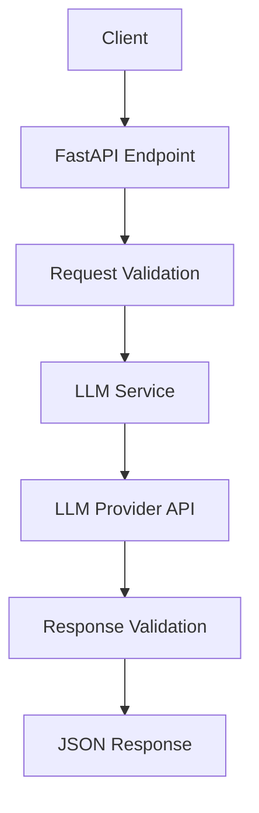

## Technical requirements

1. API Design

request 

```json
{
    message:"My payment failed. Please fix urgently"
}```

response# AI Support Ticket Analyzer — Technical Design

## 1. Problem Statement

Customer support teams receive hundreds of messages daily. Manually categorizing tickets and assigning priorities takes time.

We want to build an AI-powered API that automatically analyzes customer messages and returns structured information.

## 2. Functional Requirements

The system should:

- Accept a customer support message.
- Identify the ticket category.
- Determine the priority.
- Analyze customer sentiment.
- Generate a short summary.
- Return structured JSON.

## 3. API Design

**Endpoint:** `POST /analyze`

### Request

```json
{
  "message": "My payment failed twice. Please help urgently."
}
```

### Response

```json
{
  "category": "billing",
  "priority": "high",
  "sentiment": "negative",
  "summary": "Customer is experiencing repeated payment failures."
}
```

## 4. Data Schemas

### AnalyzeRequest

| Field | Type | Validation |
|---|---|---|
| message | string | Required, non-empty, max 5,000 characters |

### AnalyzeResponse

| Field | Type | Allowed values |
|---|---|---|
| category | string | billing, technical, account, general |
| priority | string | low, medium, high |
| sentiment | string | positive, neutral, negative |
| summary | string | Non-empty, max 300 characters |

## 5. System Architecture



## 6. Error Handling

| Scenario | HTTP status | Behavior |
|---|---|---|
| Empty message | 422 | Return validation error |
| Message exceeds limit | 422 | Return validation error |
| LLM provider timeout | 504 | Return safe error response |
| LLM provider unavailable | 503 | Return safe error response |
| Invalid LLM output | 502 | Return safe error response |

## 7. Project Structure

```text
ai-ticket-analyzer/
├── app/
│   ├── main.py
│   ├── schemas.py
│   └── llm_service.py
├── tests/
│   └── test_analyze.py
├── design.md
├── .env
├── .gitignore
└── requirements.txt
```

## 8. Non-Functional Requirements

- API keys must never be hardcoded.
- External LLM requests must have a timeout.
- Inputs and outputs must be validated.
- Errors must not expose sensitive information.
- LLM calls should be mockable for unit testing.

## 9. Testing Strategy

1. Valid billing ticket returns the expected schema.
2. Empty message returns HTTP 422.
3. Oversized message returns HTTP 422.
4. LLM timeout returns HTTP 504.
5. Invalid LLM output returns HTTP 502.

## 10. Success Criteria

The implementation is complete when:

- `POST /analyze` accepts valid messages.
- Responses conform to the defined schema.
- Invalid inputs are rejected.
- Provider errors are handled safely.
- All five tests pass.


```json
{
    {
  "category": "billing",
  "priority": "high",
  "sentiment": "negative",
  "summary": "Customer is experiencing repeated payment failures."
}
}
```

